# Evidencias APP1 — PedidoLab

**Repositorio:** https://github.com/joseastu33/icc-pap-pl1-patrones.git
**Integrantes:** José Astudillo 
**Fecha:** Cuenca, 06 de noviembre 2026

| Caso | Entrada | Resultado esperado | Resultado real | Evidencia | Estado |
|---|---|---|---|---|---|
| CA01 | `TipoProducto.CAFE, IDs P-001 y P-002`|Obtener dos clones con identificadores distintos y distintos en memoria |`P-001`, `P-002`, `false`, `false` |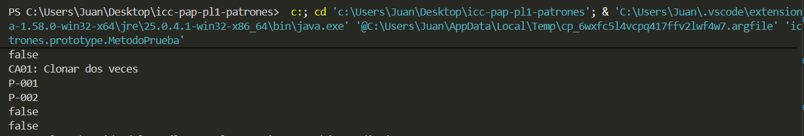 | Aprobado |
| CA02 |Comparacion `cafe1 == prototipo`  | `false`: el clon tiene que ser una instancia diferente |`false` |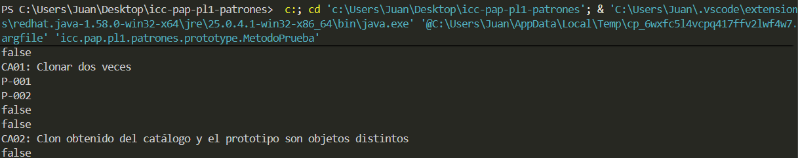 | Aprobado |
| CA03 | Primer Café + `Azucar` + `Crema` | Descripción de un Café con ambos ingredientes y precio añadido ($3.90), segundo café con precio en $2.20 |`Pedido guardado: Azucar`, `Pedido guardado: Crema`, `Cafe + Azucar + Crema`, `$3.90`|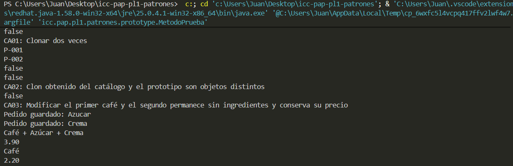 | Aprobado |
| CA04 |Consultar el segundo pedido `P-002` tras agregarle Azucar y Crema a `P-001` |`Cafe` y `2.20` sin ingredientes demás |`Cafe` y `2.20` | 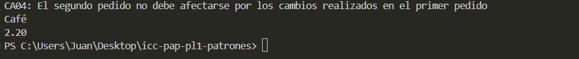| Aprobado |
| CA05 | Crear un pedido de tipo `ENSALADA` y agregarle ingredientes `Tomate` y `Pollo` |La descripción debería mostrar `Ensalada + Tomate + Pollo` junto con el precio que deberá ser de `$5.60` tras agregado los ingredientes |`Pedido guardado: Tomate`,  `Pedido guardado: Pollo`, `Ensalada sencilla + Tomate + Pollo`, `5.60`| 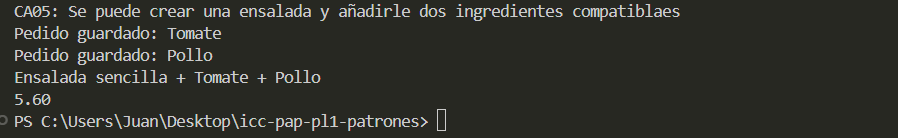| Aprobado |
| CA06 |Crear un pedido tipo `Pizza` y asignarle `Queso` y `Pepperoni` | `Pizza sencilla + Queso + Pepperoni` y `$7.10`| `Pedido guardado: Queso`, `Pedido guardado: Pepperoni`, `Pizza sencilla + Queso + Pepperoni`, `7.10`| 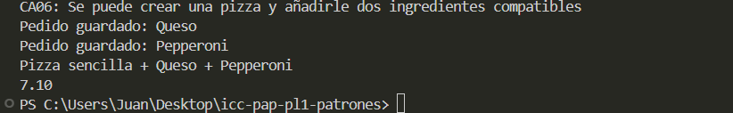| Aprobado|
| CA07 |Crear un pedido tipo `Cafe` e intentar agregarle `Queso` | Se debe rechazar el ingrediente por incompatibilidad, el pedido debería conservar su descripción `Cafe` junto con el precio original de `$2.20` sin modificaciones| `Error: Ingrediente no compatible`, `Cafe`, `$2.20`| 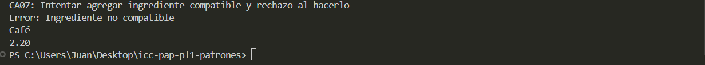| Aprobado |
| CA08 |Intenta agregar `Azucar` al pedido con un ID `P-999` inexistente  |Mostrar un error indicando que el periodo no fue encontrado y no realizar ningún cambio | `Error: Pedido no encontrado`|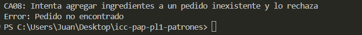 | Aprobado |
| CA09 |Solicita un producto con la clave `HAMBURGUESA` inexistente  | Rechazar la clave y mostrar un error | `Error: No enum constant icc.pap.pl1.patrones.modelo.TipoProducto.HAMBURGUESA` | 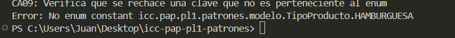 | Aprobado |
| CA10 |Crear un pedido de tipo `Cafe` y agregar `Azucar` dos veces |  `Cafe + Azucar + Azucar` y `$3.20`| `Pedido guardado: Azucar`, `Pedido guardado: Azucar`, `Cafe + Azucar + Azucar` y `$3.20`|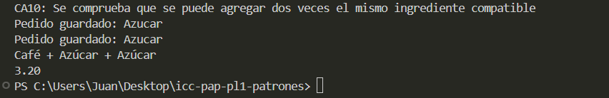 | Aprobado |
| CA11 |Ejecutar el metodo `reiniciarPedidos()` y posteriormente crear un nuevo `Cafe` |La lista de pedidos creada queda vacía, los protototipos no se eliminan y puede crearse un nuevo `Cafe` con ID `P-007`, descripción `Cafe` y precio `2.20` por ejemplo | Lista vaciada y se creó `Cafe` con los datos proporcionados| 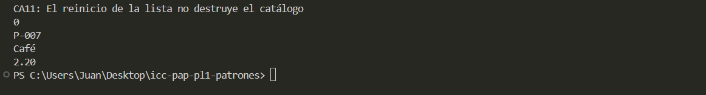 | Aprobado |

## Identificación de patrones

- **Prototype:** Clase `RegistroPrototipos` la cual almacena los prototipos originales en un mapa, usando su `TipoProducto` como clave, método `obtenerProductoDelCatalogo()` mediante el cual al solicitar un producto el registro devuelve una copia `ProductoBase` que evita copiar el objeto original. Se registra el prototipo mediante el constructor de la clase anteriormente mencionada. Archivo  `RegistroPrototipos.java`

- **Decorator:** Clase `DecoradorIngrediente` como abstracta con referencia a `Pedido` (el componente) con dos decoradores por ejemplo `Azucar` y `Crema`

- **Integración:** Metodo `agregarIngredienteAPedido()` que permite añadir un decorador inicial y a ese pedido decorado volver a decorarlo con otro, tomando en cuenta que `crearPedido()` crea el clon

## Decisiones de diseño

1. Considerando una implementacion inicial de añadir un método para validar si un tipo de producto es en concreto un tipo, se consideró que los tres metodos para los tipos (Cafe, Pizza y Ensalada) respondian a una misma pregunta ¿Que tipo es?" asi que en lugar de metodos se implementó un enum para hacer la elección más directa y hacer más directa la inaceptación de datos inválidos
(lo cual en un metodo pudo haber significado más lógica probablemente repetida)

2. Manteniendo el principio de lo que significa la interfaz gráfica, a esta se la excluyó completamente de la lógica y de la creación de pedidos, ya que únicamente corresponde a visualizar esta información mediante abstracciones (paneles, botones, checkboxes, etc.)

## Conclusiones
1. Aunque inicialmente se trabajó con patrones creacionales combinados, se observó y determinó que es perfectamente posible implementar patrones de distinta naturaleza para desarrollar soluciones complementarias. A las copias generadas por Prototype, se les añade una funcionalidad extra de estructura mediante Decorator ("con + Decorador"). Apoyando la idea de que, la combinación de estos patrones permitió que el software sea más flexible y sencillo de mantener (en lugar de tener clases, subclases, y lógica mezclada con otras responsabilidades).
2. Durante el desarrollo se mantuvieron las responsabilidades de cada parte de forma separada, lo cual permitió que el sistema pueda ser más organizado para facilitar una posible incorporación de nuevos productos/ingredientes manteniendo la lógica intacta sin cambiarla
3. El patrón Prototype permite generar objetos distintos del producto original o manteniendo caracteristicas similares al original, esto implica que las modificaciones realizadas mediante un decorador (añadir otro decorador, retirar) afectan unicamente al clon o copia.
